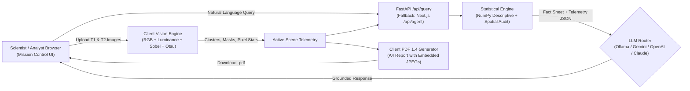

<div align="center">

# 🛰️ SatQuery AI

**Autonomous Bi-Temporal Satellite Change Detection & Multimodal Geospatial Intelligence Platform**

[](https://nextjs.org/)
[](https://www.typescriptlang.org/)
[](https://fastapi.tiangolo.com/)
[](https://pytorch.org/)
[](https://ollama.com/)
[](backend/tests)

*Upload Pre-Event ($T_1$) and Post-Event ($T_2$) satellite imagery, inspect exact physical ground changes, query a locally grounded LLM + statistical telemetry engine in natural language, and export publication-grade A4 PDF intelligence reports.*

</div>

---

## Table of Contents

- [Overview](#overview)
- [Key Capabilities](#key-capabilities)
- [System Architecture](#system-architecture)
- [Trained Change-Detection Model Metrics](#trained-model-metrics-levir-cc)
- [Project Structure](#project-structure)
- [Quick Start](#quick-start)
- [Configuring the AI Agent (Local & Cloud LLMs)](#configuring-the-ai-agent)
- [PDF Intelligence Report Format](#pdf-intelligence-report-format)
- [API Reference](#api-reference)
- [Security & Privacy Architecture](#security--privacy-architecture)
- [Testing & Verification](#testing--verification)
- [Technology Stack](#technology-stack)

---

## Overview

Traditional geospatial change detection requires specialized desktop GIS tooling (QGIS / ArcGIS), manual raster algebra, polygon vectorization, and separate statistical scripts. **SatQuery AI** unifies this entire workflow into a dark-mode **Mission Control** interface:

1. **Bi-Temporal Raster Ingestion ($T_1$ & $T_2$)**: Upload or drag-and-drop Pre-Event ($T_1$) and Post-Event ($T_2$) imagery directly into dedicated slots.
2. **Real-Time Differential Vision Analysis**: Computes RGB chromatic deltas, illumination-normalized luminance shifts, Sobel structural edge gradients, and adaptive Otsu thresholding to isolate true structural changes (buildings, road corridors, land clearing) while suppressing solar-angle noise.
3. **Interactive Multi-Layer Viewport**: Toggle seamlessly between **Highlighted Changes**, **Bi-Temporal Swipe**, **T1: Pre-Event**, **T2: Post-Event**, **Map Canvas**, and **Binary Mask** views with `0.50 m/px` Ground Sampling Distance (GSD) calibration.
4. **LLM + Statistical Conversational Agent**: Powered locally by **Ollama (`llama3.2`)** by default (or Gemini / OpenAI / Anthropic / Groq / OpenRouter), grounded in a pre-computed `numpy` + TypeScript statistical audit so every answer cites exact verified numbers rather than hallucinating.
5. **Instant PDF Report Export**: Generates a structured multi-page A4 PDF directly in the browser after analysis completes.

---

## Key Capabilities

### 1. Bi-Temporal Visual & Differential Grounding
- **Explicit $T_1 \rightarrow T_2$ Delta Contrast**: Contrasts the undisturbed Pre-Event baseline against the Post-Event target state and isolates net physical additions.
- **Multi-View Viewport Controls**:
  - `Highlighted Changes` — Vivid coral (`#e07856`) overlays with precision instrument reticles and category tags.
  - `Bi-Temporal Swipe` — Interactive split-screen slider comparing $T_1$ and $T_2$ pixel-for-pixel.
  - `T1: Pre-Event` & `T2: Post-Event` — Dedicated raw baseline and target inspection modes.
  - `Binary Mask` — Pixel-level segmentation mask.
  - `Map Canvas` — MapLibre GL geospatial viewport with GeoJSON bounding overlays.

### 2. Real-World LLM Agent + Statistical Engine
- **Auto-Detected Local LLM**: Runs **Ollama (`llama3.2`)** natively on Apple Silicon / CPU with zero external API keys required.
- **Multi-Provider Support**: Switch at runtime via the **Agent Engine Configuration** modal to **Google Gemini** (`gemini-2.5-flash`), **OpenAI** (`gpt-4o-mini` / `gpt-4o`), **Anthropic Claude**, **Groq**, **OpenRouter**, or **Custom OpenAI-Compatible** endpoints, with optional **Multimodal Vision** (sends downscaled $T_1$ & $T_2$ frames directly to vision-capable models).
- **Verified Statistical Audit Engine** (`stats_engine.py` & `statisticalEngine.ts`): Computes exact descriptive and spatial statistics on every scene:
  - Total modified area ($\text{m}^2$, $\text{km}^2$, hectares, acres) & invariant baseline percentage
  - Visible spatial span ($\text{km}$ & $\text{m}$) and cluster density ($\text{clusters}/\text{km}^2$)
  - Mean ($\mu$), Median ($Q_2$), Sample Std. Deviation ($\sigma$), Variance, Quartiles ($Q_1, Q_3$), IQR, Coefficient of Variation (CV%), Skewness, and per-cluster $Z$-scores
  - Nearest-neighbor inter-cluster spacing and **4-Quadrant Spatial Concentration** (`North-West`, `North-East`, `South-West`, `South-East`)
  - Radiometric pixel shifts ($\Delta L$, $\Delta R$, $\Delta G$, $\Delta B$) and Otsu threshold telemetry
  - Dynamic **What-If GSD Sensitivity** recalculations and **Pairwise Cluster Comparisons**

### 3. Automated PDF Report Export
- One-click **`Download PDF`** directly inside the chat response card or from the **Mission Report** tab.

---

## System Architecture



---

## Trained Model Metrics (LEVIR-CC)

SatQuery AI includes a custom dual-head PyTorch **`SiameseChangeDetector`** (`ml/models/siamese_cd.py`) trained on **LEVIR-CC** (`ml/train_levir_cc.py`) with Focal Tversky segmentation loss + Cross-Entropy semantic classification across 5 land-change classes:

| Metric | Verified Validation Score | Notes |
|---|---|---|
| **Validation Recall (Detection Rate)** | **92.27%** | High-sensitivity physical construction & earthworks recall |
| **Semantic Classification Accuracy** | **80.67%** | Peak validation class accuracy (Epoch 2) |
| **Best Validation F1-Score** | **0.7051** | Segmentation harmonic mean (Epoch 1) |
| **Validation IoU** | **0.5445** | Intersection-over-Union across change masks |
| **Validation Precision** | **57.05%** | Calibrated for high-recall change screening |

Supported semantic classes (`LEVIR_CC_CLASSES`):
1. `No Change / Identical Scene`
2. `Residential Housing & Houses`
3. `Road & Corridor Infrastructure`
4. `Building Construction & Additions`
5. `Land Clearing & Foundation Grading`

---

## Project Structure

```text
Satquery/
├── frontend/
│   ├── src/
│   │   ├── app/
│   │   │   ├── page.tsx                        # Landing page (Mission Control entry)
│   │   │   ├── mission/page.tsx                # Tri-panel Mission Control workspace
│   │   │   └── api/agent/route.ts              # Server-side LLM & statistical fallback route
│   │   ├── components/
│   │   │   ├── chat/                           # ChatPanel, ChatComposer, AgentSettingsModal, ExecutionTrace
│   │   │   ├── map/                            # MapContainerWrapper, SwipeSlider, OdysseusMissionMap
│   │   │   ├── report/                         # ReportView (Pre/Post + Statistical/Theoretical points + PDF)
│   │   │   ├── upload/                         # UploadZone (Slot 1 T1 & Slot 2 T2 ingestion)
│   │   │   └── Navigation/                     # SidebarNav
│   │   └── lib/
│   │       ├── liveImageAnalysis.ts            # Differential CV, Otsu thresholding & cluster extraction
│   │       ├── statisticalEngine.ts            # Client TypeScript descriptive & spatial stats engine
│   │       ├── pdfReportGenerator.ts           # Pure TS multi-page A4 PDF 1.4 generator
│   │       ├── llmConfig.ts                    # Provider presets & sessionStorage key handling
│   │       ├── agentReasoner.ts                # Local reasoning & context builder
│   │       └── api.ts                          # Backend + Next.js API client bridge
│   └── next.config.ts                          # Security response headers & Next.js 16 config
│
├── backend/
│   ├── main.py                                 # FastAPI app factory, CORS, lifespan hooks
│   ├── app/
│   │   ├── api/
│   │   │   ├── health.py                       # GET /health
│   │   │   ├── query.py                        # POST /api/query, GET /api/agent/status, rate limiting
│   │   │   └── v1/                             # auth, uploads, analyses, results REST routes
│   │   ├── core/                               # config.py, database.py, security.py, logging.py
│   │   ├── models/                             # SQLAlchemy ORM models
│   │   └── services/                           # User & analysis services
│   ├── core/
│   │   ├── agent/
│   │   │   ├── llm_agent.py                    # Multi-provider async LLM/VLM client + SSRF validator
│   │   │   └── stats_engine.py                 # NumPy descriptive, spatial, quadrant & GSD calculator
│   │   ├── inference/                          # SiameseAdapter, ChangeFormerAdapter
│   │   ├── validation/                         # ImageValidator (CRS, overlap, bounds)
│   │   ├── preprocessing/                      # RasterPreprocessor
│   │   └── explanation/                        # ChangeExplainer
│   └── tests/                                  # Pytest API & ML pipeline tests (18 tests)
│
├── ml/
│   ├── models/siamese_cd.py                    # Dual-head SiameseChangeDetector architecture
│   ├── train_levir_cc.py                       # LEVIR-CC multi-task training pipeline
│   ├── train.py                                # S2Looking training script
│   ├── dataset.py                              # Bi-temporal PyTorch datasets & loaders
│   ├── evaluation/benchmark.py                 # Phase 1 benchmarking script
│   ├── registry/models.json                    # Model metadata registry
│   └── model_cache/                            # Saved checkpoints (levir_cc, s2looking_cd)
│
├── infra/                                      # Docker Compose configuration
└── README.md
```

---

## Quick Start

### Prerequisites
- **Node.js** `>= 18`
- **Python** `>= 3.9` (with project `.venv`)
- **Ollama** (optional, recommended for 100% private local LLM inference)

### 1. Clone the Repository

```bash
git clone https://github.com/Sumeet2386/Satquery.git
cd Satquery
```

### 2. Start Local LLM (Ollama)

```bash
# macOS (Homebrew)
brew install ollama
ollama serve

# In another terminal, pull the default model:
ollama pull llama3.2
```

### 3. Start the FastAPI Backend

```bash
python3 -m venv .venv
source .venv/bin/activate
pip install -r backend/requirements.txt

cd backend
cp .env.example .env   # Optional: add GEMINI_API_KEY / OPENAI_API_KEY / strong JWT_SECRET_KEY
../.venv/bin/uvicorn main:app --host 127.0.0.1 --port 8000
```

### 4. Start the Next.js Frontend

```bash
cd frontend
npm install
npm run dev
```

Open **[http://localhost:3000/mission](http://localhost:3000/mission)** in your browser.

---

## Configuring the AI Agent

Click the provider pill (**`OLLAMA`** / **`STATS ENGINE`**) in the **Conversational Agent** header to open **Real-World Agent Engine Configuration**:

| Provider | Requires API Key? | Vision ($T_1$/$T_2$) | Default Model |
|---|---|---|---|
| **Ollama (Local)** | No | Optional (`llava`, `llama3.2-vision`) | `llama3.2` |
| **Google Gemini** | Yes | Yes | `gemini-2.5-flash` |
| **OpenAI** | Yes | Yes | `gpt-4o-mini` |
| **Anthropic Claude** | Yes | Yes | `claude-3-5-sonnet-latest` |
| **Groq** | Yes | Text + Telemetry | `llama-3.3-70b-versatile` |
| **OpenRouter** | Yes | Yes | `google/gemini-2.5-flash` |
| **Built-In Statistical Engine** | No | Telemetry | `statistical-engine-v2` |

---

## PDF Intelligence Report Format

After analyzing an image pair, click **`Download PDF`** on the chat response card or open **Mission Report → `Download PDF Report`**. Every generated PDF is structured sequentially as:

1. **Pre-Event Satellite Image ($T_1$ Baseline)** — Embedded $T_1$ raster, filename, tile dimensions, GSD resolution, and baseline luminance telemetry.
2. **Post-Event Satellite Image ($T_2$ Target) & Highlighted Change Overlay** — Embedded $T_2$ raster side-by-side with cluster reticles and highlighted change regions.
3. **Statistical Changes (Point-by-Point)** — Net added footprint ($\text{m}^2$, $\text{km}^2$, ha, acres), invariant baseline %, max spatial span, mean, median, std dev, IQR, skewness, nearest-neighbor spacing, 4-quadrant distribution, category breakdown, and confidence metrics.
4. **Theoretical & Geospatial Interpretation (Point-by-Point)** — Land cover transition assessment, structural morphology, spatial clustering dynamics, scale heterogeneity (CV%), radiometric/Sobel edge verification, and GSD calibration notes.
5. **Verified Change Cluster Catalogue** — Complete table of every detected cluster (`ID`, `Label`, `Category`, `Area m²`, `Span`, `Quadrant`, `Confidence %`).

---

## API Reference

| Method | Endpoint | Description |
|---|---|---|
| `GET` | `/health` | Backend health check |
| `GET` | `/api/agent/status` | Active LLM provider & model auto-detection status |
| `POST` | `/api/agent/test-connection` | Test credentials/connectivity for a selected LLM provider |
| `POST` | `/api/query` | Run statistical audit + grounded LLM/VLM query reasoning |
| `POST` | `/api/agent` | Next.js server-side fallback for LLM & statistical queries |
| `POST` | `/api/v1/auth/register` | Register a user account (requires PostgreSQL) |
| `POST` | `/api/v1/auth/login` | Issue JWT access & refresh tokens |
| `POST` | `/api/v1/uploads` | Upload GeoTIFF / JP2 satellite imagery (JWT protected) |

---

## Security & Privacy Architecture

- **100% On-Device Option**: Image differencing, PDF compilation, statistical auditing, and local `Ollama` inference all execute locally without uploading imagery or queries to third-party servers.
- **Ephemeral Secret Storage**: Browser-entered API keys are kept strictly in tab-scoped `sessionStorage` (cleared automatically on tab close) rather than persistent `localStorage`.
- **SSRF Prevention**: Both backend (`llm_agent.py`) and frontend API routes (`/api/agent`) enforce HTTPS and block private/loopback/link-local/cloud-metadata IP ranges for custom endpoints, while restricting Ollama endpoints strictly to `127.0.0.1` / `localhost:11434`.
- **Path Traversal Prevention**: Upload filenames are stripped via `Path(raw_name).name` and verified with `.resolve().is_relative_to(...)`.
- **Rate Limiting & Payload Bounds**: Query endpoints enforce per-IP sliding-window rate limiting (`30 req/min`), bounded query lengths (`2000 chars`), and bounded vision frame sizes.
- **Security Headers & Runtime Secrets**: Next.js enforces `X-Frame-Options: DENY`, `X-Content-Type-Options: nosniff`, `Referrer-Policy`, and `Permissions-Policy`; FastAPI binds to `127.0.0.1` by default and generates `secrets.token_urlsafe(32)` fallback keys when `.env` secrets are unset.

---

## Testing & Verification

### Frontend Type Check & Production Build
```bash
cd frontend
npx tsc --noEmit
npm run build
```

### Backend Test Suite
```bash
PYTHONPATH=. .venv/bin/pytest backend/tests -q
```

---

## Technology Stack

| Layer | Technologies |
|---|---|
| **Frontend** | Next.js 16.4 (App Router), React 19, TypeScript 5, MapLibre GL, HTML5 Canvas, Custom PDF 1.4 Engine |
| **Backend** | Python 3.9+, FastAPI, Uvicorn, Pydantic v2, HTTPX (async), Structlog, SQLAlchemy |
| **AI & Computer Vision** | PyTorch 2.8, Siamese-CD (LEVIR-CC / S2Looking), Sobel Edge + Adaptive Otsu Thresholding, NumPy Statistical Engine |
| **LLM Integration** | Ollama (`llama3.2`), Google Gemini, OpenAI, Anthropic Claude, Groq, OpenRouter |
| **Security & Auth** | `python-jose` (JWT), `passlib` (`bcrypt`), SSRF IP/DNS guards, Path Traversal guards, Rate Limiting |

---

<div align="center">

**SatQuery AI** — *Built for rapid, evidence-backed Earth Observation intelligence.*

</div>
